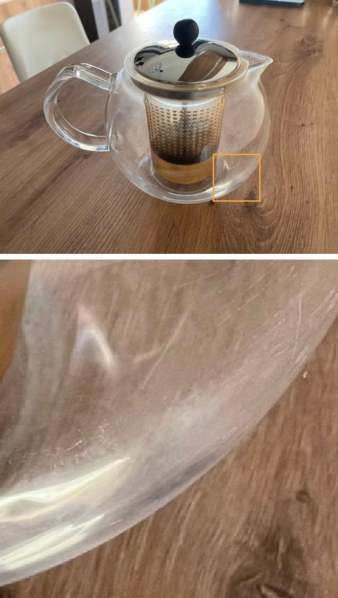
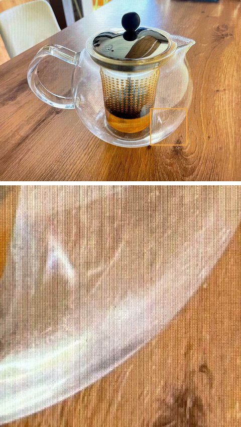

# Détection de photos recapturées

Projet d'apprentissage profond du master Informatique ISICG (Université de Limoges, 2024).

Une photo recapturée est la photo d'un écran ou d'une impression. Le programme dit si une image est une photo directe ou une recapture.

| Photo directe | Photo de cette photo affichée sur un écran (recapture) |
|:---:|:---:|
|  |  |

*La même scène photographiée directement, puis photographiée sur un écran. En dessous, un agrandissement de la zone encadrée : la recapture laisse apparaître la trame de l'écran, que les descripteurs cherchent à détecter.*

## Méthode

1. **Descripteurs** (`Recapture/features/`) : descripteurs d'après l'article [Recaptured image forensics based on local ternary count of high order prediction error](https://doi.org/10.1016/j.image.2022.116662) (Signal Processing: Image Communication, 2022) : erreurs de prédiction d'ordre élevé, différences secondes et comptes ternaires locaux (LTC), soit un vecteur de 324 valeurs par image.
2. **Classifieur** (`Recapture/training.py`) : réseau de neurones dense (324-128-64-1) en Keras, avec réduction du taux d'apprentissage et sauvegarde du meilleur modèle.
3. **Évaluation** (`Recapture/tests.py`) : jeu de test séparé, avec recadrages aléatoires. **91 % de précision** sur le jeu de test.

Des photos capturées et recapturées à la main servent de tests supplémentaires (`Capture_manuelle_tests/`, `Recapture_manuelle_tests/`).

## Utilisation

```bash
cd Recapture
python3 training.py      # entraînement (ou chargement du modèle de modele/)
python3 prediction.py    # prédiction sur un dossier d'images
python3 tests.py         # évaluation
```

Nécessite Python 3, TensorFlow/Keras, scikit-learn, scikit-image et NumPy. Les descripteurs et les poids entraînés sont fournis dans `modele/`.

## Technologies

Python, TensorFlow/Keras, scikit-learn, scikit-image, NumPy.
